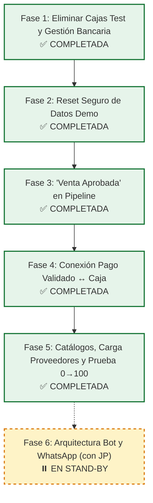

# Plan de Implementación por Fases — Ajustes Octubre 2026 (Parte 2: Hormiglass CRM)

> **Ubicación del archivo:** `local/ajustes/octubre/2/PLAN-FASES.md`  
> **Fecha de creación:** 10 de octubre de 2026  
> **Fuente:** `local/ajustes/octubre/2/` (Audios 1 al 5 de Mariela Valverde + captura de pipeline + requerimientos operacionales).  
> **Regla de ejecución:** **Una fase a la vez**, con verificación funcional, pruebas y validación del usuario antes de iniciar la siguiente.

---

## 1. Contexto y Objetivos

Mariela Valverde (Gerencia / Operaciones Hormiglass) requiere preparar el sistema para iniciar la **operación real "de 0 a 100"** (Ciclo comercial completo: Cliente → Cotización → Pago → Validación en Caja → Venta Aprobada → Fabricación/Reventa → Despacho → Entrega y Cobranza).

Para lograr este arranque limpio y sin fricciones operativas, se levantaron 5 requerimientos críticos distribuidos en 5 audios:
1. **Audio 1:** Eliminación masiva de datos demo y transacciones de prueba (OC, cotizaciones, notas de venta, clientes ficticios) para operar con documentos oficiales.
2. **Audio 2:** Dificultad para eliminar cajas de prueba ("BancoEstado Operaciones Test") en el módulo de Caja/Finanzas y depurar cuentas bancarias para dejar solo las 8 oficiales.
3. **Audio 3:** Conectar la etapa "Pago Validado" del pipeline comercial con el módulo de Caja/Finanzas (notificación a finanzas, conciliación con la cartola bancaria y actualización automática de estado).
4. **Audio 4:** Incongruencia de la etapa "Venta Cerrada" en la sección Comercial antes de Producción → Renombrar a **"Venta Aprobada"** y reservar el cierre definitivo para la entrega física acreditada.
5. **Audio 5:** Confirmación del catálogo de productos, preparación de base de proveedores para carga masiva, ejecución de prueba integral 0 a 100, y especificación técnica de la integración del bot y WhatsApp (en coordinación con JP).

---

## 2. Decisiones de Diseño Confirmadas

En la sesión de definición se confirmaron los siguientes criterios arquitectónicos:

1. **Etapa "Venta Cerrada" → Renombrar a "Venta Aprobada":**
   - La etapa se mantiene en la sección Comercial y Ventas (antes de Producción), representando la **aprobación comercial y compromiso del pedido**.
   - Se elimina la exigencia de guía de despacho firmada para esta etapa.
   - El cierre real y acreditado de la venta se preserva en los estados finales de cada rama operativa (`prod_finalizado` y `rev_entregado`).
2. **Alcance del Reset de Datos Demo:**
   - **Se borra:** Operación y transacciones (oportunidades, cotizaciones, abonos, movimientos de caja de prueba, órdenes de compra de prueba, guías de despacho, eventos de planificación, clientes demo, notificaciones transaccionales).
   - **Se conserva:** Catálogos maestros (348 productos en `catalogo_productos`, usuarios de sistema, empresas del holding, las 8 cuentas bancarias reales, categorías y subcategorías de caja, personal de RRHH, campos personalizados).
3. **Automatización Pago Validado ↔ Caja:**
   - Cuando la vendedora sube el comprobante de abono, Finanzas recibe notificación en tiempo real con enlace directo a Caja.
   - Cuando Finanzas valida el abono en Caja (asociándolo a la cuenta bancaria de destino), la oportunidad avanza automáticamente a **"Pago Validado"** sin necesidad de mover la tarjeta manualmente.

---

## 3. Matriz de Trazabilidad: Requerimientos vs. Fases

| Audio | Requerimiento de Mariela | Entregable Técnico | Fase |
|---|---|---|---|
| **Audio 2** | No puede eliminar cajas "BancoEstado Operaciones Test" | Botón eliminar en UI con confirmación + protección de movimientos + limpieza de las 3 cajas test | **Fase 1** |
| **Audio 1** | Eliminación masiva de datos demo (clientes, cotizaciones, OC, ventas) | RPC segura de reset con dry-run y confirmación escrita + limpieza de storage + respaldo previo | **Fase 2** |
| **Audio 4** | "Venta Cerrada" mal ubicada antes de Producción | Renombrar a **Venta Aprobada** en UI/tipos, retirar bloqueo de acreditación de entrega en esa etapa | **Fase 3** |
| **Audio 3** | Conectar Pago Validado con Finanzas y Caja | Auto-transición a `pagada` al conciliar abono en Caja, notificaciones realtime y badge en Navbar | **Fase 4** |
| **Audio 5** | Catálogo de proveedores, OC reales y prueba 0→100 | Verificación de catálogo de productos, importador de proveedores, libreto y ejecución de prueba integral | **Fase 5** |
| **Audio 5** | Bot de mensajería (JP) y diseño de WhatsApp en CRM | Especificación de arquitectura (webhook/API/tablas) y diseño de UI (pestaña cliente + vista global) | **Fase 6** |

---

## 4. Detalle de Fases de Implementación

### Fase 1: Eliminación de Cajas de Prueba y Gestión de Bancos (Audio 2) — ✅ COMPLETADA (10-Oct-2026)
*Objetivo:* Permitir a Finanzas/Admin gestionar y eliminar cuentas bancarias sin movimientos, depurando las 3 cajas "Test" creadas.

- **Diagnóstico en código y BD:**
  - `public.cuentas_bancarias` contenía 11 registros: 8 cuentas reales y 3 de prueba (`ad786d5a...`, `388780b5...`, `3e9bf03f...`).
  - La interfaz `app/caja/configuracion/page.tsx` solo contaba con toggle de activación y botón de edición (`Edit2`), careciendo de acción para eliminar.
  - Las FK en `caja_movimientos` y `abonos` tenían `ON DELETE SET NULL`, por lo que borrar una cuenta con movimientos dejaría registros huérfanos.
- **Acciones implementadas y verificadas:**
  1. **UI:** Se agregó el botón `Eliminar` (ícono `Trash2` con `IconButton`) en la tabla de cuentas bancarias de `app/caja/configuracion/page.tsx`, protegido para roles `admin` y `finanzas`.
  2. **Validación defensiva en UI:** Consulta reactiva y concurrente de movimientos (`caja_movimientos`) y abonos (`abonos`). Si posee registros vinculados, bloquea el borrado con aviso toast: *"No se puede eliminar la cuenta porque tiene X registro(s) contables asociados. Desactívela en su lugar para mantener la integridad histórica"*.
  3. **Trigger de Seguridad en Base de Datos:** Se creó la migración `20261010143500_proteger_y_gestionar_eliminacion_cuentas_bancarias.sql` con el trigger `trg_proteger_eliminacion_cuenta_bancaria` (`BEFORE DELETE ON cuentas_bancarias`) que levanta excepción con código `23503` si se intenta borrar una cuenta con movimientos o abonos.
  4. **Auditoría:** Se extendió `lib/logger.ts` para registrar auditoría de creación y eliminación de cuentas bancarias en `logs_sistema`.
  5. **Depuración en BD:** Se eliminaron las 3 cuentas de prueba de BancoEstado que tenían 0 movimientos. Quedan exactamente las 8 cuentas oficiales del holding.
  6. **Pruebas y Verificación:** Se creó test unitario `tests/cuentas-bancarias-seguridad.test.mjs` (26/26 tests pasando), `npx next build` exitoso (38/38 rutas compiladas sin errores), y `npm run lint:design` con 0 violaciones de tokens.
- **Estado de Aceptación:**
  - ✅ Botón de eliminar visible y accesible en `/caja/configuracion`.
  - ✅ Confirmación modal antes de eliminar implementada vía `useConfirm`.
  - ✅ Cuentas con movimientos quedan protegidas a nivel de UI y a nivel de base de datos.
  - ✅ Quedan exactamente las 8 cuentas bancarias operativas reales en Supabase.
  - ✅ Registro de auditoría verificado en `logs_sistema`.

---

### Fase 2: Reset Seguro de Datos Demo de Operación (Audio 1) — ✅ COMPLETADA (10-Oct-2026)
*Objetivo:* Limpiar todas las transacciones de prueba creadas durante la fase de desarrollo para permitir a Mariela operar desde cero con datos reales.

- **Diagnóstico en código y BD:**
  - Existían registros de prueba en `oportunidades` (9), `cotizaciones` (12), `clientes` (8), `abonos` (4), `caja_movimientos` (5), `ordenes_compra` (5), `guias_despacho` (6), etc.
  - Se requerían protecciones estrictas para que ningún catálogo maestro (348 productos, usuarios, empresas, cuentas bancarias, RRHH) pudiera ser afectado.
- **Acciones implementadas y verificadas:**
  1. **Respaldo previo:** Se generó y validó el backup completo de las 32 tablas operativas en `.backups/backup-pre-reset-20261010.json` (141 KB).
  2. **Migración SQL y RPC Atómica:** Se creó la migración `supabase/migrations/20261010150000_reset_datos_operacion.sql` y se implementó la función PostgreSQL `public.reset_datos_operacion(p_confirmacion text, p_dry_run boolean)`:
     - `SECURITY DEFINER` y `SET search_path = ''`.
     - Control estricto de acceso exclusivo para rol `admin`.
     - Modo `dry_run = true` por defecto: devuelve conteos precisos de las 24 entidades operativas sin modificar la base de datos.
     - Modo ejecución: requiere obligatoriamente la frase textual `'BORRAR OPERACION HORMIGLASS'`.
     - Cascada segura vía `TRUNCATE CASCADE` sobre todas las tablas operativas de transacciones.
     - **Catálogos maestros 100% preservados:** `catalogo_productos` (348), `cuentas_bancarias` (8), `empresas` (3), `usuarios` (2), categorías de caja y RRHH intactos.
     - Limpieza de storage en bucket `documentos` para eliminar archivos huérfanos de pruebas.
     - Auditoría automática: registra en `logs_sistema` la ejecución del reset con usuario, fecha y conteos.
  3. **UI Administrativa (Zona de Peligro):**
     - Se añadió la pestaña **"Zona de peligro (Mantenimiento)"** en [`app/configuracion/page.tsx`](file:///Users/jesusrodriguez/Claude%20Code/projects/hormiglass-system/app/configuracion/page.tsx), visible únicamente para usuarios con rol `admin`.
     - Incluye botón de simulación "Simular reset" con visualización en cuadrícula de todos los conteos operacionales detectados.
     - Campo de texto que exige la frase `'BORRAR OPERACION HORMIGLASS'` y botón destructivo con confirmación modal `useConfirm`.
  4. **Ejecución y Verificación en Vivo:**
     - Se ejecutó el reset en la base de datos de Supabase.
     - **Conteos verificados post-reset:**
       - `catalogo_productos`: 348 (Intacto)
       - `cuentas_bancarias`: 8 (Intacto)
       - `empresas`: 3 (Intacto)
       - `usuarios`: 2 (Intacto)
       - `clientes`: 0
       - `oportunidades`: 0
       - `cotizaciones`: 0
       - `abonos`: 0
       - `caja_movimientos`: 0
       - `ordenes_compra`: 0
       - `guias_despacho`: 0
       - `actividades_op`: 0
  5. **Pruebas y Verificación:**
     - Test unitario [`tests/reset-datos-operacion.test.mjs`](file:///Users/jesusrodriguez/Claude%20Code/projects/hormiglass-system/tests/reset-datos-operacion.test.mjs) creado (31/31 tests pasando en suite).
     - `npx next build`: 38/38 rutas compiladas con 0 errores.
     - ESLint y `npm run lint:design` sin advertencias ni violaciones de tokens.

---

### Fase 3: "Venta Cerrada" → "Venta Aprobada" y Ajuste del Pipeline (Audio 4) — COMPLETADA ✅
*Objetivo:* Alinear el embudo comercial con la realidad operativa, renombrando la etapa preliminar a "Venta Aprobada" y reservando el finiquito de venta para la entrega acreditada en producción/reventa.

- **Diagnóstico en código y BD:**
  - El valor interno de etapa es `entregada` (`EstadoPipeline` en `lib/types.ts`), pero en la interfaz se rotulaba como "Venta Cerrada".
  - En `app/ventas/page.tsx:2577,2790` se mostraba el texto `"0 acreditadas · 0 registros"` y se aplicaba la regla de `isUnaccreditedClose` basada en `entrega_acreditada`.
  - El trigger de base de datos `validar_cierre_venta` bloqueaba la transición a `entregada` si no existía entrega acreditada (`entrega_acreditada(id)`).
  - Mariela requirió que esta etapa represente la confirmación comercial que autoriza el paso a fabricación o adquisición, sin exigir guía física firmada antes de fabricar.
- **Acciones Implementadas:**
  1. **Base de Datos (Migración y Trigger):**
     - Creada y aplicada migración [`supabase/migrations/20261010153000_venta_aprobada_pipeline.sql`](file:///Users/jesusrodriguez/Claude%20Code/projects/hormiglass-system/supabase/migrations/20261010153000_venta_aprobada_pipeline.sql).
     - Actualizada la función `validar_cierre_venta()`: el estado `'entregada'` ("Venta Aprobada") fue removido de la validación bloqueante de entrega acreditada.
     - La exigencia estricta de `entrega_acreditada(NEW.id)` se mantiene activa e inviolable exclusivamente para `'prod_finalizado'` y `'rev_entregado'`.
  2. **Tipos y Constantes del Pipeline:**
     - En `lib/types.ts`: documentado el estado `'entregada'` como Venta Aprobada (cierre comercial; no exige guía previa).
     - En `SECCIONES_PIPELINE` (`app/ventas/page.tsx`): etapa renombrada a `"Venta Aprobada"`.
     - En `PIPELINE_STAGES` y `getStageIndex` (`app/ventas/page.tsx` y `app/ventas/[id]/page.tsx`): sincronizado el riel macro de estados con etapa 3 `"Venta Aprobada"`, seguida de abastecimiento/fabricación y finalizada en cierre/entrega.
  3. **Desbloqueo Operativo y Eliminación de Alertas Erróneas:**
     - En `moveOportunidadToState` (`app/ventas/page.tsx`) y `handleCambiarEtapa` (`app/ventas/[id]/page.tsx`): eliminada la llamada bloqueante a `entrega_acreditada` al mover a `'entregada'`. El modal de asignación de rama (Producción vs Reventa) se despliega sin trabas.
     - En `isUnaccreditedClose`: removido `'entregada'`; las ventas aprobadas ya no muestran el badge `"Entrega sin acreditar"` ni `"0 acreditadas · X registros"`.
     - En vistas de operaciones (`app/ventas/[id]/operacion/page.tsx`), clientes (`app/clientes/[id]/page.tsx`) y dashboard (`app/page.tsx`): exclusión de `'entregada'` de la lista de entregas sin acreditar y cómputo de "Venta Aprobada" en el embudo comercial.
  4. **Pruebas y Verificación:**
     - Creado test unitario [`tests/pipeline-venta-aprobada.test.mjs`](file:///Users/jesusrodriguez/Claude%20Code/projects/hormiglass-system/tests/pipeline-venta-aprobada.test.mjs) (35/35 tests pasando en suite general).
     - `npx next build`: 38/38 rutas compiladas sin errores.
     - `npm run lint:design`: 0 violaciones de tokens de diseño.
     - Catálogos maestros intactos (348 productos, 8 cuentas bancarias).

---

### Fase 4: Conexión Pago Validado ↔ Caja y Notificaciones Finanzas (Audio 3) — ✅ COMPLETADA (10-Oct-2026)
*Objetivo:* Vincular en tiempo real la subida de comprobantes de pago por parte de ventas con la revisión contable en Caja y el avance automático de la oportunidad.

- **Diagnóstico en código y BD:**
  - Al subir un comprobante se llamaba a `registrar_abono_atomico`, pero el movimiento de la oportunidad a la etapa `pagada` ("Pago Validado") se realizaba manualmente en el Kanban.
  - La función `validar_abono` creaba el movimiento en `caja_movimientos`, pero no actualizaba el estado de la oportunidad asociada ni emitía feedback bidireccional.
  - El Navbar no contaba con badge de notificaciones en tiempo real para alertar de nuevos abonos.
  - El dashboard en `app/page.tsx` filtraba abonos con `estado = 'pendiente_validacion'`, lo que causaba un desfase con la BD cuyo constraint solo admite `'pendiente'`.
- **Acciones implementadas y verificadas:**
  1. **Base de Datos y Migración SQL:**
     - Creada y aplicada la migración [`supabase/migrations/20261010160000_conectar_pago_validado_caja_y_notificaciones.sql`](file:///Users/jesusrodriguez/Claude%20Code/projects/hormiglass-system/supabase/migrations/20261010160000_conectar_pago_validado_caja_y_notificaciones.sql) en Supabase.
     - **Normalización de Empresas:** Razón social actualizada a `"Sociedad Inmobiliaria Hormiglass SpA"` (RUT 77.615.313-3) para `slug = 'inmobiliaria'`.
     - **Automatización en `public.validar_abono()`:** Al conciliar un abono en Caja contra una cuenta bancaria oficial, si la oportunidad se encuentra en `'nueva'`, avanza automáticamente a `estado_pipeline = 'pagada'` ("Pago Validado"), registra el hito en `actividades_op`, y emite notificación en tiempo real tanto a la vendedora asignada como a quien subió el comprobante con deep link a `/ventas/<opId>`.
     - **Reversión en `public.rechazar_abono()`:** Si Finanzas rechaza un abono y no quedan otros abonos validados, la oportunidad regresa a `'nueva'` y notifica al equipo comercial con el motivo del rechazo.
     - **Alerta Comercial en `public.registrar_abono_atomico()`:** Al cargar un comprobante, el sistema notifica en tiempo real a usuarios con rol `admin` y `finanzas` con deep link `/caja?tab=validacion&abono=<id>`.
  2. **Interfaz de Caja y Deep Linking:**
     - En [`app/caja/page.tsx`](file:///Users/jesusrodriguez/Claude%20Code/projects/hormiglass-system/app/caja/page.tsx): integrado soporte de `useSearchParams` (`?tab=validacion` y `?abono=<id>`) con tab activo y resaltado visual del abono.
     - Al validar un abono, se despliega confirmación toast informativa avisando la conciliación bancaria y el avance automático de la oportunidad a "Pago Validado".
  3. **Badges en Tiempo Real:**
     - En [`components/Sidebar.tsx`](file:///Users/jesusrodriguez/Claude%20Code/projects/hormiglass-system/components/Sidebar.tsx): agregado badge con conteo de abonos pendientes sobre el módulo de "Caja" para roles `admin` y `finanzas` con suscripción activa a cambios en `public.abonos`.
     - En [`components/Navbar.tsx`](file:///Users/jesusrodriguez/Claude%20Code/projects/hormiglass-system/components/Navbar.tsx): agregado badge numérico sobre el ícono de campana para notificaciones no leídas de `public.notificaciones_sistema` con refresco en tiempo real.
     - En [`app/page.tsx`](file:///Users/jesusrodriguez/Claude%20Code/projects/hormiglass-system/app/page.tsx): corregido el filtro a `estado = 'pendiente'`.
  4. **Pruebas y Verificación:**
     - Creado test unitario [`tests/pago-validado-caja.test.mjs`](file:///Users/jesusrodriguez/Claude%20Code/projects/hormiglass-system/tests/pago-validado-caja.test.mjs).
     - Suite completa ejecutada: **39/39 tests unitarios pasando exitosamente**.
     - `npx next build`: **38/38 rutas compiladas sin errores**.
     - `npm run lint:design`: **48 archivos verificados con 0 violaciones de tokens**.
     - Catálogos maestros intactos: 348 productos, 8 cuentas bancarias, 3 empresas oficiales.

---

### Fase 5: Catálogos, Carga Masiva y Prueba Integral 0→100 (Audio 5) — ✅ COMPLETADA (10-Oct-2026)
*Objetivo:* Dejar depurado y verificado el catálogo oficial de proveedores, habilitar la herramienta de carga masiva y validar operativamente el ciclo completo de negocio de 0 a 100.

- **Diagnóstico en código y BD:**
  - `catalogo_productos` contaba con sus 348 productos oficiales intactos post-reset.
  - En `public.proveedores` residía un proveedor de prueba (`DEMO Proveedor de Vidrios`, RUT `DEMO-PROVEEDOR-01`) sin productos asociados y el nombre de Macbal figuraba como `MAC-BAL SA CODEX TEST`.
  - La interfaz de proveedores en `app/proveedores/page.tsx` no contaba con herramienta de importación masiva ni descarga de plantillas oficiales para Mariela.
- **Acciones implementadas y verificadas:**
  1. **Base de Datos y Migración SQL:**
     - Creada y aplicada la migración [`supabase/migrations/20261010170000_depurar_proveedores_y_carga_masiva.sql`](file:///Users/jesusrodriguez/Claude%20Code/projects/hormiglass-system/supabase/migrations/20261010170000_depurar_proveedores_y_carga_masiva.sql).
     - Eliminado el proveedor demo `DEMO Proveedor de Vidrios`.
     - Normalizado el nombre de `MAC-BAL SA CODEX TEST` a `MACBAL S.A.`.
     - Quedan exactamente los 5 proveedores oficiales activos: Atrio Baldosas, Bottai S.A., Cementos Polpaico S.A., MACBAL S.A. y Melón Hormigones.
     - Agregadas columnas `rubro TEXT` y `activo BOOLEAN DEFAULT true` en `public.proveedores`.
     - Creado índice único normalizado sobre el RUT: `uq_proveedores_rut_norm`.
     - Implementada la función RPC atómica `public.upsert_proveedores_masivo(p_proveedores jsonb)` con auditoría en `logs_sistema`.
  2. **Módulo y Parser de Proveedores CSV/Excel:**
     - Creado [`lib/proveedores-csv.ts`](file:///Users/jesusrodriguez/Claude%20Code/projects/hormiglass-system/lib/proveedores-csv.ts) con validador de RUT chileno (algoritmo Módulo 11 con modos estricto y flexible), mapeo tolerante de cabeceras en español y generador de plantillas en `.csv` y `.xlsx`.
  3. **Interfaz de Proveedores:**
     - En [`app/proveedores/page.tsx`](file:///Users/jesusrodriguez/Claude%20Code/projects/hormiglass-system/app/proveedores/page.tsx): agregados botones para "Plantilla Excel" y "Plantilla CSV", modal de importación masiva con drag & drop, tabla de previsualización, conteos de validación, confirmación atómica y buscador reactivo.
     - Formulario manual con indicador visual en tiempo real de validez de RUT chileno.
  4. **Suite y Playbook de Prueba Integral 0 a 100:**
     - Creado el Playbook oficial en [`local/ajustes/octubre/2/PLAYBOOK-PRUEBA-0-A-100.md`](file:///Users/jesusrodriguez/Claude%20Code/projects/hormiglass-system/local/ajustes/octubre/2/PLAYBOOK-PRUEBA-0-A-100.md) documentando los 10 pasos operativos con capturas de flujo y criterios de éxito.
     - Creada suite automatizada en [`tests/flujo-integral-0-a-100.test.mjs`](file:///Users/jesusrodriguez/Claude%20Code/projects/hormiglass-system/tests/flujo-integral-0-a-100.test.mjs) (8/8 pasos probados con éxito).
     - Creada suite unitaria en [`tests/proveedores-csv.test.mjs`](file:///Users/jesusrodriguez/Claude%20Code/projects/hormiglass-system/tests/proveedores-csv.test.mjs) (6/6 tests probados con éxito).
  5. **Verificación Global:**
     - Suite general completa: **53/53 tests pasando (100%)**.
     - `npx next build`: **38/38 rutas compiladas con 0 errores**.
     - `npm run lint:design`: **48 archivos verificados con 0 violaciones**.
     - Catálogos maestros en Supabase: 348 productos, 8 cuentas bancarias, 3 empresas y 5 proveedores oficiales.

---

### Fase 6: Especificación Técnica Bot y WhatsApp en CRM (Audio 5 - con JP) — ⏸️ EN STAND-BY (10-Oct-2026)
*Estado:* **Pausada temporalmente por definición operativa.** Las ejecutivas comerciales continúan utilizando el bot en ClickUp mientras se consolida la operación de 0 a 100 en el CRM Hormiglass.

- **Definición de Usuario (10-Oct-2026):**
  - La gerencia resolvió dejar la integración de WhatsApp y el bot en pausa temporal para enfocar los esfuerzos en la adopción operativa del CRM (Cotizaciones, Validación en Caja, Producción y Logística).
  - La arquitectura y especificación de endpoints con JP se retomará una vez finalizado el ciclo de estabilización con usuarios reales.
- **Alcance preservado para reactivación futura:**
  1. Definición de proveedor de mensajería (WhatsApp Business Cloud API vs. Twilio / Z-API).
  2. Tablas relacionales `whatsapp_conversaciones` y `whatsapp_mensajes` en Supabase.
  3. Pestaña de WhatsApp en `/clientes/[id]` y bandeja general de entrada.

---

## 5. Cronograma y Estado Final del Plan

1. **Fase 1 (Completada):** Cuentas bancarias depuradas y protegidas contra borrado accidental con movimientos. Quedan las 8 cuentas oficiales.
2. **Fase 2 (Completada):** Reset atómico de 0 transacciones de prueba ejecutado. 348 productos, usuarios y empresas 100% preservados.
3. **Fase 3 (Completada):** Etapa "Venta Aprobada" desbloqueada para fabricar y comprar sin exigir guía física antes de producir.
4. **Fase 4 (Completada):** Conciliación en Caja auto-avanza a "Pago Validado", notificaciones inmediatas y badges realtime.
5. **Fase 5 (Completada):** Depuración de proveedores, módulo de importación masiva CSV/Excel con Módulo 11, Playbook y suite E2E de 0 a 100.
6. **Fase 6 (En Stand-by):** Bot y WhatsApp pospuestos para etapa posterior.

---

## 6. Procedimientos de Seguridad y Respaldo

- **Antes de Fase 2:** Ejecución obligatoria de script de exportación/backup de tablas en el directorio `.backups/`.
- **Verificación de build y linters:** Cada fase debe finalizar con `npm run build` sin errores adicionales y cumplimiento de tokens de diseño.
- **Revisión de Advisors Supabase:** Tras cada migración de base de datos se ejecutará la inspección de Advisors de Supabase para garantizar integridad de RLS y funciones `SECURITY DEFINER`.
