# Playbook Operativo: Ciclo de 0 a 100 — Hormiglass CRM

> **Documento:** Guía de Pruebas de Extremo a Extremo (E2E)  
> **Destinatarios:** Mariela Valverde (Operaciones/Finanzas), Felipe Valverde (Gerencia) y Equipo Comercial  
> **Fecha:** Octubre 2026  
> **Objetivo:** Ejecutar una simulación real sin fricciones de todo el ciclo de negocio sobre la base de datos limpia.

---

## 🎯 Resumen del Flujo de 0 a 100

```mermaid
flowchart LR
    P1["1. Cliente<br/>(Creación)"] --> P2["2. Cotización<br/>(Catálogo 348)"]
    P2 --> P3["3. Oportunidad<br/>('Nueva')"]
    P3 --> P4["4. Abono<br/>(Ventas sube PDF)"]
    P4 --> P5["5. Caja & Banco<br/>(Validación Finanzas)"]
    P5 --> P6["6. Pago Validado<br/>(Auto-avance)"]
    P6 --> P7["7. Venta Aprobada<br/>(Derivación)"]
    P7 --> P8["8. Abastecimiento<br/>(OC Proveedor)"]
    P8 --> P9["9. Despacho<br/>(Guía + Firma)"]
    P9 --> P10["10. Cierre<br/>('Prod. Finalizado')"]

    style P1 fill:#f1f5f9,stroke:#64748b;
    style P5 fill:#dbeafe,stroke:#2563eb;
    style P6 fill:#e0e7ff,stroke:#4f46e5;
    style P7 fill:#fef3c7,stroke:#d97706;
    style P9 fill:#dcfce7,stroke:#16a34a;
    style P10 fill:#d1fae5,stroke:#059669;
```

---

## 📋 Pasos Detallados para la Simulación

### Paso 1: Crear o Seleccionar un Cliente
1. Ingresar a `/clientes` y pulsar **"+ Nuevo Cliente"**.
2. Ingresar datos reales o de prueba formal:
   - **Nombre / Razón Social:** Constructora Los Robles SpA
   - **RUT:** `77.615.313-3` (o cualquier RUT con dígito verificador válido)
   - **Teléfono:** `+56 9 8765 4321`
   - **Correo:** `contacto@losrobles.cl`
   - **Comuna:** San Bernardo / Las Condes
3. Guardar el cliente.

### Paso 2: Crear Cotización con Productos del Catálogo Oficial
1. Ir a `/cotizaciones/nuevo?cliente_id=<id_del_cliente>`.
2. Agregar productos seleccionando desde el selector (hay 348 productos disponibles):
   - Ejemplo: *Pastelón 50x50* (cantidad: 80, precio unitario referencial).
   - Ejemplo: *Solera Tipo A* (cantidad: 15).
3. Verificar que el desglose de **Subtotal Neto**, **IVA (19%)** y **Total Bruto** se calcule automáticamente.
4. Presionar **"Guardar y Enviar Cotización"**.

### Paso 3: Crear Oportunidad Comercial en el Pipeline
1. En `/ventas`, pulsar **"+ Agregar Oportunidad"**.
2. Asociar el cliente y la cotización creada.
3. La tarjeta aparecerá inmediatamente en la primera columna: **"Nueva Oportunidad"**.

### Paso 4: Vendedora Registra Abono (Anticipo 50%)
1. Abrir la oportunidad en `/ventas/<id>`.
2. En la sección **"Abonos y Comprobantes de Pago"**, pulsar **"Registrar Abono"**.
3. Ingresar el monto (ej. `$250.000`), fecha y subir cualquier comprobante en PDF o imagen.
4. Presionar **"Guardar Abono"**.
5. **Resultado esperado:**
   - El abono queda en estado **"Pendiente de Validación"**.
   - Se emite una alerta en tiempo real a Finanzas (`admin` y `finanzas`).
   - El badge de la campana en el Navbar y el contador sobre "Caja" en el menú lateral aumentan a **+1**.

### Paso 5: Finanzas Concilia y Valida el Pago en Caja
1. Mariela o Finanzas hace clic en la notificación o navega a `/caja?tab=validacion`.
2. El sistema resalta el abono pendiente de `$250.000`.
3. Seleccionar la **cuenta bancaria oficial de destino** donde ingresó el dinero (ej. *Banco de Chile Inmobiliaria - Cta Cte 00-123-45678-00*).
4. Pulsar **"Validar Abono"**.
5. **Resultado esperado:**
   - Se crea el movimiento de ingreso contable en `caja_movimientos`.
   - El abono queda en estado `validado`.
   - Aparece un toast confirmando: *"Abono validado y conciliado en Banco de Chile. La oportunidad avanzó automáticamente a Pago Validado"*.

### Paso 6: Verificación de Avance Automático
1. Volver a `/ventas` (Pipeline).
2. Comprobar que la tarjeta de la oportunidad se movió **automáticamente** desde "Nueva Oportunidad" hacia la columna **"Pago Validado"** sin intervención manual.

### Paso 7: Pase a "Venta Aprobada" y Derivación Operativa
1. Cuando el equipo comercial confirma el pedido, arrastrar la tarjeta o cambiar la etapa a **"Venta Aprobada"** (anteriormente "Venta Cerrada").
2. Se desplegará el modal de confirmación solicitando la rama operativa:
   - Seleccionar **"Producción y Logística"** (o Reventa según corresponda).
3. **Regla de negocio validada:** No se solicita guía de despacho firmada en este punto porque la producción aún no inicia.

### Paso 8: Abastecimiento y Orden de Compra de Materias Primas
1. Ir a `/proveedores` o `/ordenes-compra/nuevo`.
2. Generar una orden de compra oficial hacia uno de los proveedores reales (ej. *Cementos Polpaico S.A.* o *Bottai S.A.*).
3. Vincular la OC con la oportunidad para control de costos de la matriz de margen.

### Paso 9: Fabricación, Guía de Despacho y Acreditación de Entrega
1. Mover la orden en Producción a través de `En cola` -> `En fabricación` -> `Listo para despacho`.
2. En la ficha de operación (`/ventas/<id>/operacion`), emitir la **Guía de Despacho**.
3. Registrar la recepción física del cliente:
   - Nombre de quien recibe.
   - Firma o fotografía de la guía timbrada/firmada (`entrega_acreditada = true`).

### Paso 10: Cierre Definitivo de la Operación
1. Con la entrega físicamente acreditada, mover la oportunidad a **"Producción Finalizada"** (`prod_finalizado`).
2. El trigger de base de datos valida la existencia de la acreditación documental y aprueba el cierre definitivo de la venta y liquidación de costos.

---

## 🛠️ Herramienta de Carga Masiva de Proveedores
Para cuando Mariela tenga lista la planilla de proveedores:
1. Ir a `/proveedores`.
2. Pulsar **"Plantilla Excel"** para descargar el formato oficial.
3. Rellenar las columnas: `RUT`, `Razón Social`, `Contacto`, `Teléfono`, `Correo`, `Dirección`, `Comuna`, `Rubro`.
4. Pulsar **"Importar Proveedores"**, arrastrar el archivo y presionar **"Confirmar e Importar"**.
5. El sistema validará automáticamente los RUTs con Módulo 11 y registrará el catálogo sin duplicados.
